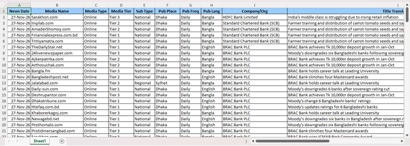
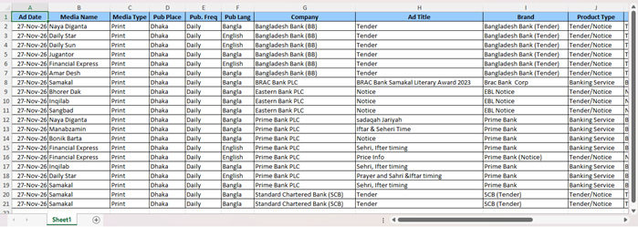

## Screenshots

### Processed News Report



### Processed Advertisement Report




# HDFC Media Monitoring Report Automation with Python

Automating News and Print Advertisement media monitoring report processing using Python, Pandas and OpenPyXL.

> **Portfolio demonstration:** This project uses demo/anonymized data and a simulated reporting workflow. It is not commissioned by, endorsed by, or affiliated with HDFC Bank Limited.

## Overview

This project automates the processing of two separate Excel datasets—News and Advertisement—through a single Python script. It applies predefined filtering, transformation, sorting and formatting rules, then exports two separate processed Excel workbooks.

## Features

### News report
- Filters records using a configured list of 12 companies and organizations.
- Replaces `National` with `Print` in `Media Type`.
- Updates `News Date` to the processing date in `DD-MMM-YY` format.
- Removes unnecessary columns.
- Arranges records according to a configured organization-priority sequence.
- Applies standardized Excel formatting.

### Advertisement report
- Filters records using a configured list of 14 companies and organizations.
- Replaces `National` with `Print` in `Media Type`.
- Updates `Ad Date` to the processing date in `DD-MMM-YY` format.
- Removes `Ad Link` and `Reporter`.
- Retains records categorized as `Print`.
- Arranges records according to the configured company sequence and applies standardized formatting.

### Excel formatting
- Thin black borders across used cells.
- Blue header fill (`#99CCFF`).
- Bold header text.
- Centered horizontal and vertical header alignment.
- Adjusted column widths.

## Workflow

```text
HDFC_News.xlsx ─┐
                ├─ Python automation ─┬─ HDFC_news_processed.xlsx
HDFC_Ads.xlsx ──┘                   └─ HDFC_ads_processed.xlsx
```

## Input and output files

Place both input workbooks in the same folder as the script.

| Input | Output |
|---|---|
| `HDFC_News.xlsx` | `HDFC_news_processed.xlsx` |
| `HDFC_Ads.xlsx` | `HDFC_ads_processed.xlsx` |

The script reads the input files and creates separate processed outputs.

## News priority sequence

1. HDFC Bank Limited
2. Standard Chartered Bank (SCB)
3. BRAC Bank PLC
4. Eastern Bank PLC
5. Prime Bank PLC
6. Bangladesh Bank (BB)
7. Bangladesh Financial Intelligence Unit (BFIU)
8. National Board of Revenue (NBR)
9. Banking Industry

Other retained organizations outside this priority sequence follow the priority-ranked records.

## Requirements

- Python 3
- Pandas
- OpenPyXL

Dependencies are listed in `requirements.txt`.

## Installation

1. Install Python 3.
2. Download or clone this repository.
3. Install dependencies:

   ```bash
   pip install -r requirements.txt
   ```

4. Place `HDFC_News.xlsx` and `HDFC_Ads.xlsx` beside the script.

## Usage

Run from the project folder:

```bash
python HDFC_Bank_Excel_Report_Automated_with_Python.py
```

The processed workbooks will be generated in the project folder.

## Performance

Three documented test runs:

| Records | Manual processing | Automated processing | Time reduction |
|---:|---:|---:|---:|
| 517 | 9.36 min | 5.17 sec | 99.08% |
| 545 | 9.87 min | 5.44 sec | 99.08% |
| 498 | 9.02 min | 5.06 sec | 99.06% |

| Average metric | Result |
|---|---:|
| Manual processing time | ~9.42 min |
| Automated processing time | ~5.22 sec |
| Average time reduction | ~99.07% |

*These figures reflect the three test runs documented for this portfolio project and are not a universal benchmark.*

## Technical implementation

- **Python:** Workflow orchestration and automation.
- **Pandas:** Reading, filtering, transforming and sorting data.
- **OpenPyXL:** Excel workbook formatting and file handling.

The script uses paths relative to its own location rather than fixed absolute paths.

The Advertisement workflow includes a workbook-style compatibility workaround that creates a temporary cleaned copy for processing and removes it after the processing attempt. The original input workbook is intended to remain untouched.

## Repository contents

```text
HDFC_Media_Monitoring_Report_Automation_with_Python/
├── README.md
├── HDFC_Bank_Excel_Report_Automated_with_Python.py
├── requirements.txt
└── .gitignore
```

## Disclaimer

This repository is a portfolio demonstration using demo/anonymized data and a simulated reporting workflow. It is not affiliated with, commissioned by, endorsed by or sponsored by HDFC Bank Limited. The organization name is used solely to frame the demonstration project.
